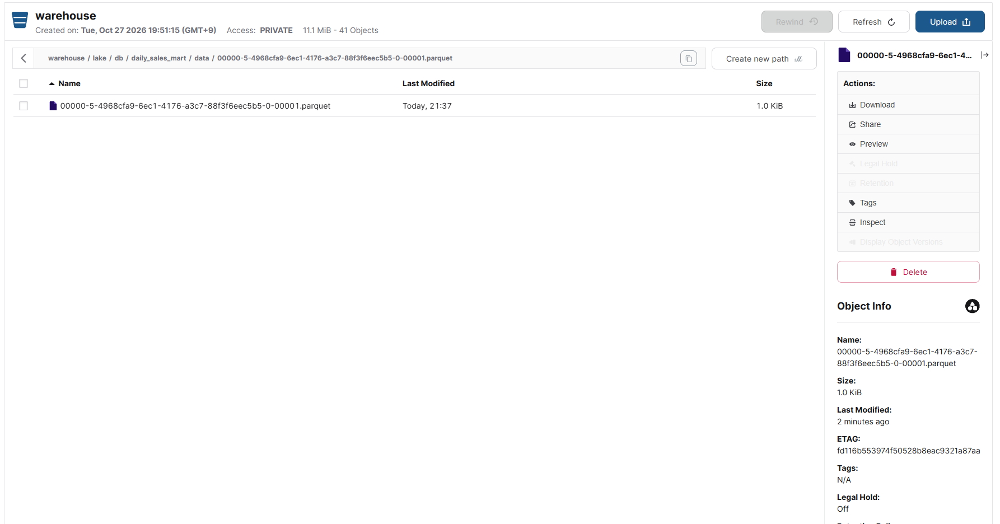

# data-eng week5 — Spark 파티션·셔플 실습과 일별 매출 데이터 마트

## 구성
- Spark 3.5.3 Standalone: 마스터 1 + 워커 2, 전체 4코어
- Docker Compose / WSL2, MinIO(S3A), Iceberg 1.5.2 Hadoop 카탈로그
- 배치: `mart.py` (날짜 인자, 처리 건수 로그, 빈 원천 검증 포함)

## 처리 흐름
주문 5행과 상품 3행 → 상품 ID 조인 → 수량 × 가격 → 날짜별 매출·주문 건수 집계 → coalesce(1) → lake.db.daily_sales_mart 교체 저장 → 조회

## 확인한 결과
2026-10-29 실제 mart.log에서 아래 결과와 완료 메시지를 확인했다. `mart-result.log`는 해당 로그의 처리 건수·표·완료 메시지만 발췌한 파일이다.

| 날짜 | daily_amount | order_cnt |
|---|---:|---:|
| 2026-08-24 | 113000 | 2 |
| 2026-08-25 | 1155000 | 2 |
| 2026-08-26 | 46000 | 1 |



위 캡처 시점에는 `warehouse/lake/db/daily_sales_mart/data/`에 Parquet 파일 1개(1.0 KiB)를 확인했다. 이후 재실행 시 과거 스냅샷의 파일이 남을 수 있으므로 폴더 전체 파일 수와 현재 테이블 파일 수는 구분한다.

## 실측과 검증 범위
| 항목 | 결과 |
|---|---|
| 기본 파티션 수 | 4 (실습 콘솔에서 확인) |
| repartition(8) | 8 |
| coalesce(2) | 2 |
| 이어서 DataFrame.coalesce(16) | 8 — 연속 coalesce의 실행 계획 최적화 관찰 |
| AQE 끔, shuffle.partitions 200 vs 8 시간 | 미측정 / 제출 자료에서 확인 불가 |
| coalesce 전/후 파일 수 | 전: 미측정 / 후: 캡처 시점 1개 |
| 스큐 Task Max / Median | 미측정 |
| 전체 날짜 결과 | 이전 콘솔 결과와 현재 mart.log의 3행·금액 동일 |
| 없는 날짜 종료 코드 1 | 코드에 구현됨, 별도 실행 결과 미확인 |

## 실행
기존 수업용 Docker Compose 환경의 `week5` 폴더에서 실행한다. 저장소에는 기존 클러스터 설정을 포함하지 않았다. 실제 로컬 코드의 접속 키 하드코딩은 제출본에서 환경변수로 변경했다. 공개 제출본 자체의 Spark 재실행 검증은 아직 하지 않았다.

```bash
read -r -p 'MinIO access key: ' MINIO_ACCESS_KEY
read -r -s -p 'MinIO secret key: ' MINIO_SECRET_KEY
echo
export MINIO_ACCESS_KEY MINIO_SECRET_KEY

docker compose cp mart.py spark-master:/tmp/mart.py
docker compose exec -T \
  -e MINIO_ACCESS_KEY -e MINIO_SECRET_KEY \
  spark-master /opt/spark/bin/spark-submit \
  --master spark://spark-master:7077 \
  --conf spark.jars.ivy=/tmp/.ivy2 \
  --packages org.apache.hadoop:hadoop-aws:3.3.4,org.apache.iceberg:iceberg-spark-runtime-3.5_2.12:1.5.2 \
  /tmp/mart.py > mart.log 2>&1
echo "종료 코드: $?"
```

선택적으로 `/tmp/mart.py 2026-08-24`처럼 날짜를 전달할 수 있다. 날짜 지정 실행도 **테이블 전체를 해당 날짜 결과로 교체**하므로 날짜별 누적 적재 방식은 아니다. 날짜 인자가 없으면 전체 3일을 처리한다.

## 해결한 문제
기존 PySparkShell이 전체 4코어를 사용해 daily-sales-mart가 코어 0개, WAITING 상태였다. 기존 셸 종료 후 배치가 실행되어 결과 표와 저장 파일을 확인했다. 작업을 수동 중단했을 때 나온 SparkContext 종료 오류는 해당 중단에 따른 메시지였다.
